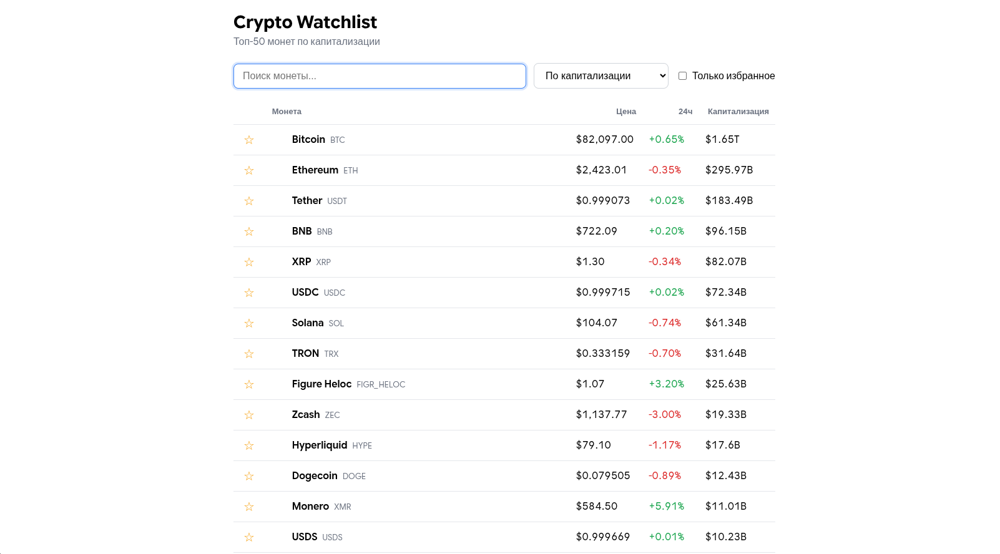

# Crypto Watchlist

A responsive dashboard for tracking the top 50 cryptocurrencies by market cap. Built with React and Vite on top of the public CoinGecko API.



## Features

- Top 50 coins with price, 24h change and market cap
- Search by name or ticker with debounce
- Sorting by price and 24h change
- Favorites persisted in `localStorage`
- Loading and error states with a retry button
- Responsive layout, accessible controls (ARIA labels, keyboard focus)

## Tech Stack

- **React** (hooks, `memo`, `useMemo`, `useCallback`)
- **Vite** for dev server and build
- **CSS Modules** for scoped component styles
- **ESLint** with the React Hooks ruleset
- **CoinGecko API** (public endpoint, no key required)

## Architecture

The code is split into three layers with one-way dependencies:

```
services  →  hooks  →  components
(data)      (logic)      (UI)
```

```
src/
├── components/   # presentational components (props in, JSX out)
├── hooks/        # useFetch, useDebounce, useLocalStorage, useCoins
├── services/     # API calls (plain JS, no React)
├── utils/        # pure formatting helpers
├── App.jsx       # composition of the screen
└── main.jsx
```

Key decisions:

- **Custom hooks** keep logic out of components: `useFetch` handles loading/error state and cancels stale requests via `AbortController`; `useCoins` combines data, search, sorting and favorites into a single interface for the UI.
- **Derived data** (filtered and sorted list) is computed with `useMemo` instead of being duplicated in state.
- **API layer isolated** in `services/`, so the data source can change without touching the UI.
- **Favorites store only coin ids**, while fresh prices always come from the API.
- **Formatting** relies on `Intl.NumberFormat` (currency, compact market cap).

## Getting Started

Requires Node.js 20.19+.

```bash
git clone https://github.com/Hasan-cloud272/crypto-watchlist.git
cd crypto-watchlist
npm install
npm run dev
```

Open http://localhost:5173.

### Scripts

| Command | Description |
|---|---|
| `npm run dev` | Start the dev server |
| `npm run build` | Production build into `dist/` |
| `npm run preview` | Preview the production build |
| `npm run lint` | Run ESLint |

## Notes on the API

The free CoinGecko endpoint has a rate limit. When it is exceeded, the app shows an error message with a retry button. Coin icons are loaded from CoinGecko's CDN and hidden gracefully if they fail to load.

## Roadmap

- [ ] 7-day price sparkline for each coin
- [ ] Currency switch (USD / EUR)
- [ ] Auto-refresh with request caching
- [ ] Unit tests for hooks and utils

## Author

**Hasan**: [GitHub](https://github.com/Hasan-cloud272)